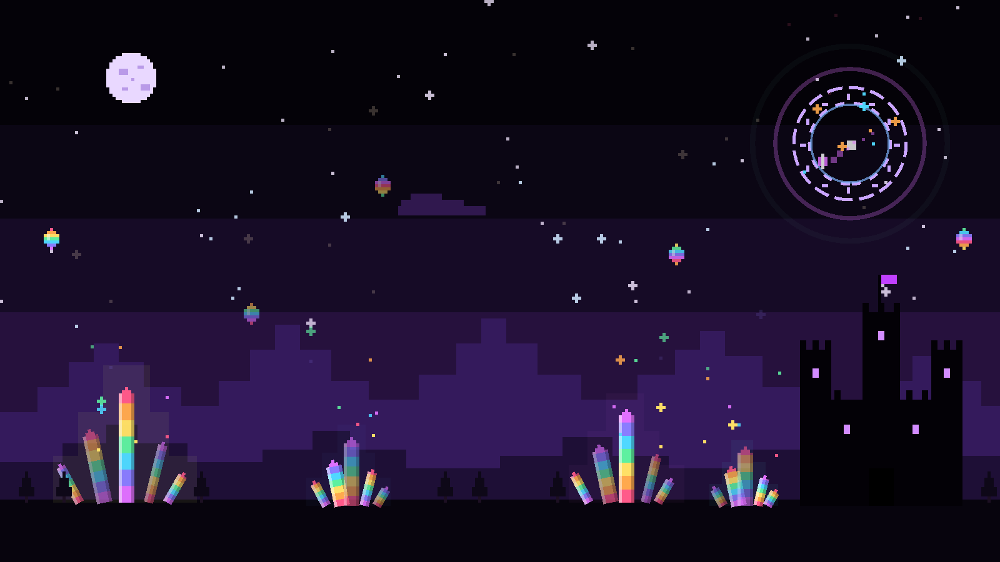

# Pixel Quest for T3 Code

A JRPG pixel-art night theme for [T3 Code](https://github.com/pingdotgg/t3code): a deep violet palette and an animated 16-bit scene behind your chat. Stars twinkle, a spell sigil turns and flings bolts, rainbow crystals shimmer while mana motes rise off them, and a little castle keeps its windows lit.

## Install

1. Download [`pixel-quest.json`](pixel-quest.json). On the file page, use the download button, or save the **Raw** view.
2. In T3 Code, open **Settings → Appearance** and click **Add a theme**.
3. Drop `pixel-quest.json` into the box, or paste its contents, and add it.
4. Pick **Pixel Quest** for the dark half of the color scheme, and switch T3 Code to dark mode (or System, if your OS is in dark mode).

That's it. The whole theme, including the animated scene, lives in that one file.

## Notes

- **Dark only.** Pixel Quest is a dark theme. Use it with dark mode.
- **Needs a T3 Code build with themes.** The theme system shipped in August 2026, so update if you don't see Settings → Appearance → Add a theme.
- **Web and desktop.** The mobile app doesn't use custom themes.
- **Reduced motion.** If your OS has Reduce Motion turned on, the scene pauses.
- **No network.** The scene is an inline SVG with CSS animations, so nothing is fetched from anywhere.
